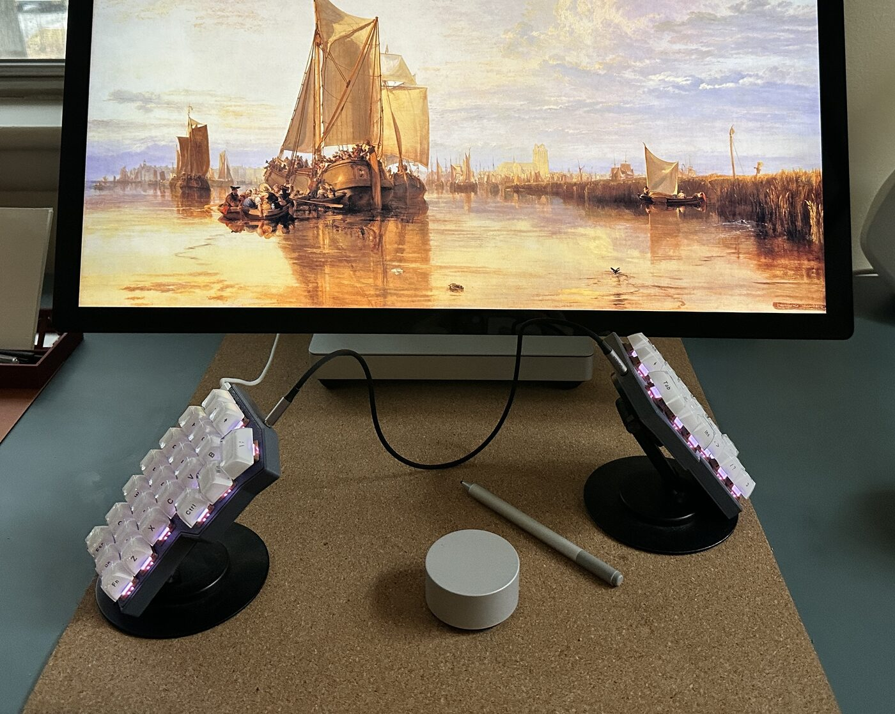
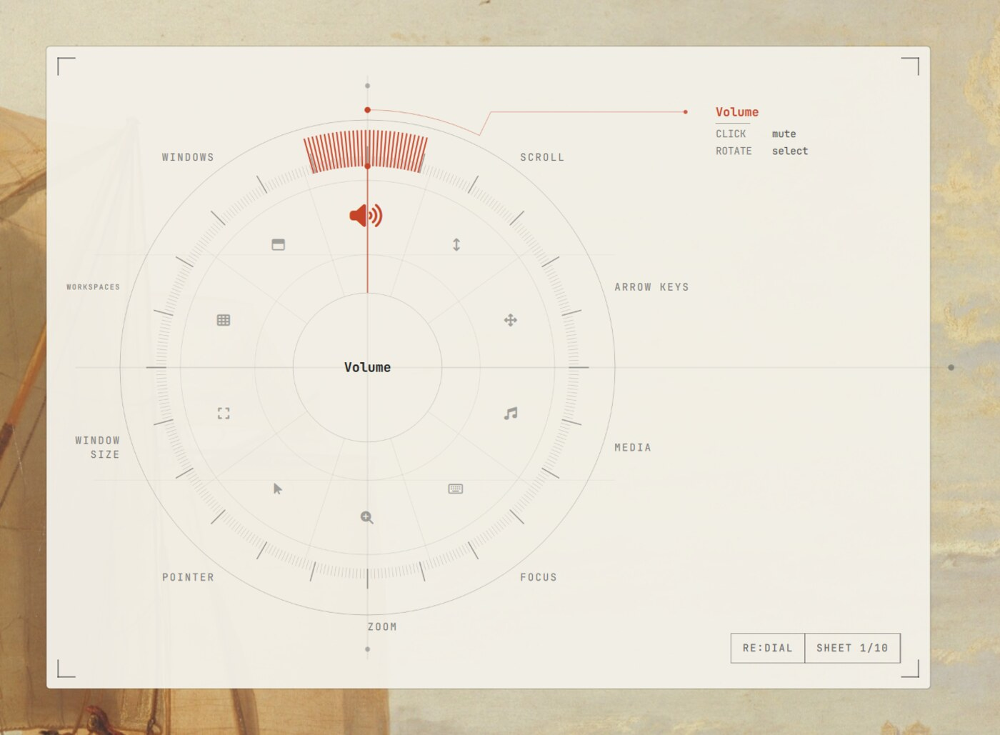
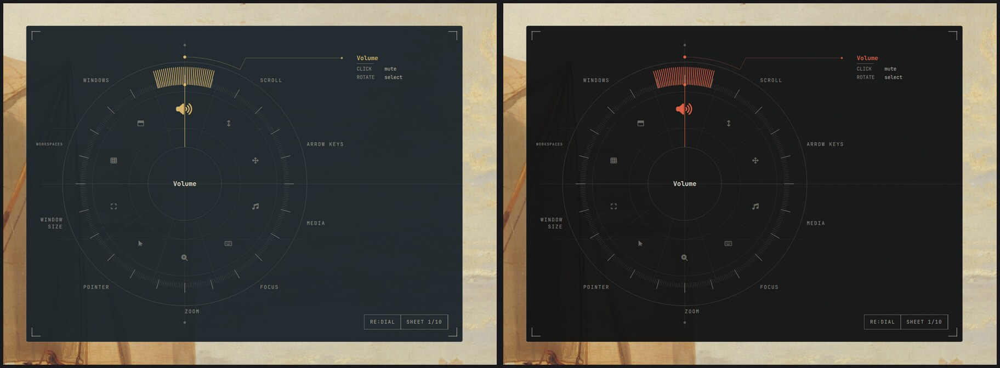
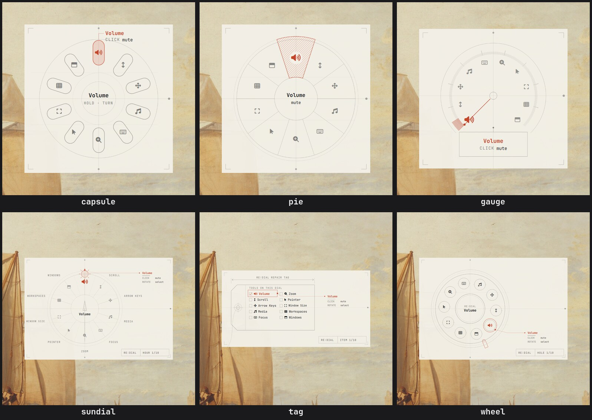
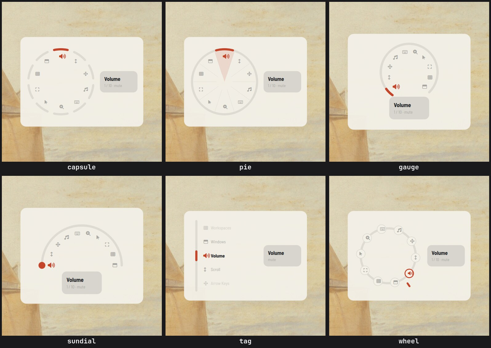
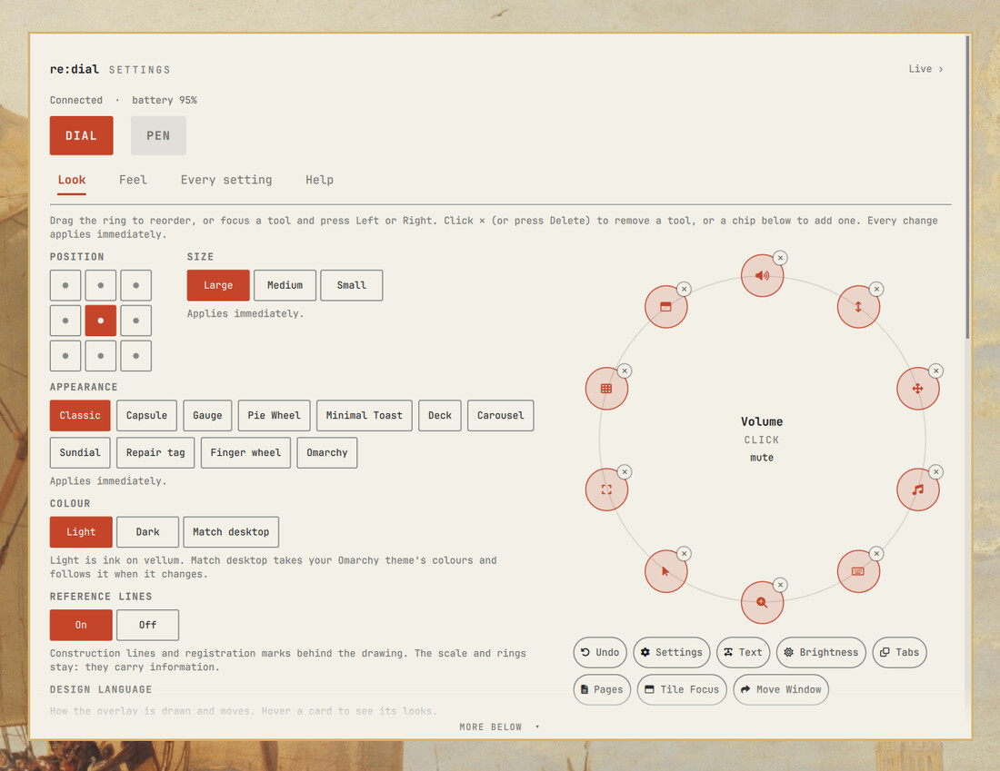
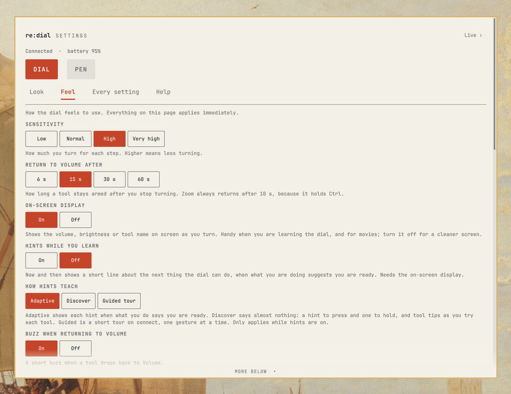
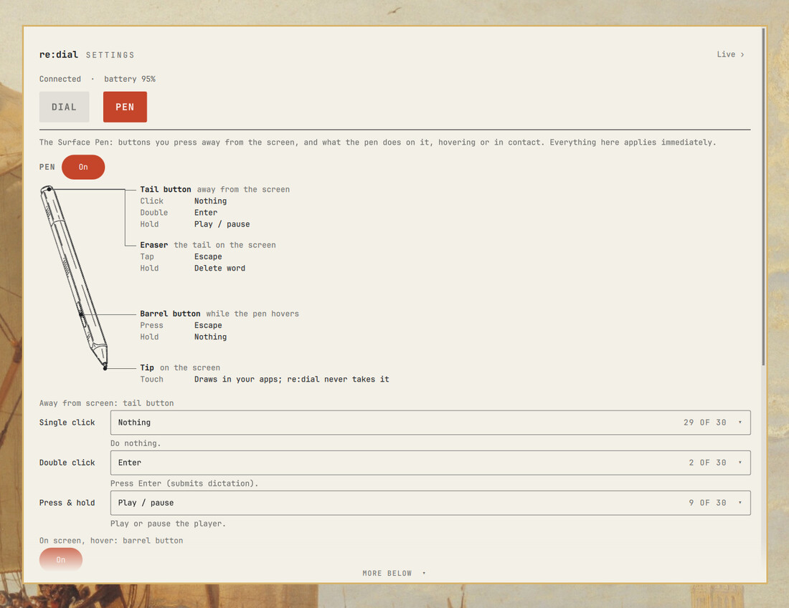

# re:dial

Use a Microsoft Surface Dial (and Surface Pen) as a control for your Omarchy desktop.



A haptic knob for your Omarchy desktop. Turn it for volume, scroll, zoom, media
scrubbing, brightness, window and workspace control; press and hold to pick a tool;
click for whatever you set. An on-screen overlay shows what's armed, in a look that
follows your Omarchy theme. The Surface Pen's tail and barrel buttons and eraser
share the same daemon.

It is a Linux userspace daemon plus an Omarchy/Quickshell plugin, built for
Hyprland + [Omarchy](https://omarchy.org) (a separate project; install it first). The point is that good hardware shouldn't become e-waste
because its maker moved on.

Microsoft discontinued the Surface Dial.
[daniel5151/surface-dial-linux](https://github.com/daniel5151/surface-dial-linux)
is the existing Linux userspace daemon, in maintenance mode per its author.
This is an independent implementation and shares no code with it.

## What it looks like

Hold the dial and the tool ring opens; turn to pick, let go to choose. The callout names the tool
and what one click does with it armed.



It can follow your Omarchy theme's colours, or use a dark plate:



**Six faces**, each drawn as a technical drawing in the *re:dial classic* design language:



**The same six in *re:dial basic***, a quieter flat style. Design languages are folders of QML;
you can make your own (`plugin/redial/languages/README.md`).



**Four other layouts**: a fanned deck of cards (the side cards show the tools either side), a
carousel strip, a one-line toast, and a card in Omarchy's own on-screen-display style.


### Settings

Everything applies as you change it. **Look**: position, size, appearance and colour, and the
tools on the ring (drag to reorder; the centre says what a click does).



**Feel**: sensitivity, how long a tool stays armed, the on-screen display, learning hints, and a
buzz when a tool returns to Volume. Every option is a large button with a sentence saying what
it does.



**Pen**: the Surface Pen's tail button, eraser and barrel button, each with its own actions.



## What's here

- `redial/` — the daemon (Python, standard library only, one module per job; map in CONTRIBUTING.md): rotation, clicks, haptics,
  the tool library, and the Surface Pen's tail button / barrel button /
  eraser drag-scroll. `bin/redial-hypr` starts it.
- `bin/redial-language` — checks, installs and removes design languages.
- `bin/redial-setup` — doctor/setup script: permissions, udev rule,
  Bluetooth pairing, autostart, plugin status. Safe to re-run any time.
- `bin/redial-bar`, `bin/redial-rise-widget` — status line and
  installer for a "re:dial" tile on the Quickshell **Rise** bar.
- `plugin/redial/` — the Quickshell/Omarchy plugin: the live tool
  overlay and the settings window (tools, position/size, click gestures for
  both the dial and the pen). See **its own README** for the full design,
  configuration reference, IPC, and action vocabulary — this file is just
  the install/overview layer.
- `udev/70-redial.rules` — hidraw + uinput permissions.
- `scripts/pair-dial.sh` — scan, pair, trust, and connect over Bluetooth.
- `tests/test_dial.py` — daemon regression suite. `python3 tests/test_dial.py`
  tests the copy in this repo; `DIAL_LIB=~/.local/share/redial/lib
  python3 tests/test_dial.py` tests a live install.
- `manifest.json` — makes this repo a plugin `omarchy plugin add` accepts.
- `scripts/add-menu-entry.py` — adds Setup > re:dial to the Omarchy menu.
- `scripts/make-installer.sh` — builds the single-file installer for a release (see `docs/RELEASING.md`).
- `uninstall.sh` — removes what `install.sh` added (backs it up first; keeps your settings).
- `install.sh` — installs all of the above. Idempotent, shows its plan and asks once
  (plus separately for the shell restart, sudo steps and the Rise widget), and backs up
  anything it would overwrite.

## Install

On Omarchy, two commands (replace the URL with this repo's):

```
omarchy plugin add https://github.com/bybrooksco/redial.git --enable
~/.config/omarchy/plugins/redial/install.sh
```

The first is Omarchy's own plugin installer and puts the overlay in place. The second
installs the daemon, starts it at login, adds **Setup > re:dial** to the Omarchy menu,
and handles the permissions the dial needs. Update later with
`omarchy plugin update redial`.

Or clone it anywhere and run `bash install.sh`, which does the same without
`omarchy plugin add`.

**Not on Omarchy?** (KDE Plasma, Ubuntu/GNOME, COSMIC, plain Hyprland, Sway, niri.) Run
`bash install-generic.sh`. You get the dial, haptics, tools and pen buttons, without the on-screen
overlay or settings window. `docs/PLATFORMS.md` says what works on each desktop.

Run it inside your own Hyprland session — it needs that environment for
`omarchy-shell`, and it asks for sudo itself only where it's actually needed
(the udev rule, adding yourself to the `input` group). Nothing is ever run
with sudo on your behalf silently. See `SECURITY.md` for what those permissions mean.

Open the settings from the Omarchy menu (`SUPER+SPACE` > Setup > re:dial). To open
them with a key instead, bind `omarchy-shell dialtools toggle` in
`~/.config/hypr/bindings.lua`.

Once it's running, see `plugin/redial/README.md` for configuration —
tool selection, click gestures (dial and pen), position/size, colors.

### Uninstall

`bash uninstall.sh` reverses the install: it stops the daemon, removes the programs, the plugin,
the start-at-login lines and the menu entry, moving each to a backup folder first. It keeps your
settings unless you pass `--purge`, and asks before its one `sudo` step (the udev rule).

## Hardware

| Device | What it needs | Status |
|---|---|---|
| **Surface Dial** | Bluetooth. Pair it once (below). | Works; used daily |
| **Surface Pen: tail button** | Pair the pen over Bluetooth (below). | Works on the Surface Studio; should work on any machine the pen pairs with |
| **Surface Pen: barrel button and eraser scroll** | The Surface Studio's built-in screen digitizer (`Surface Touch Device Stylus`) | Works on a Surface Studio 2+. **Not supported on Surface Laptop/Pro yet:** their pens appear under a different device name, which re:dial does not recognise. `STYLUS_DEVICE` does not get around this, because re:dial still checks the name. |
| **Pen tip (drawing, hover, pressure)** | Nothing. It is the screen's own digitizer. | re:dial never takes it over |

**Pairing the dial:** hold the small button on the underside until the white light flashes, then
run `scripts/pair-dial.sh` (or pair it from your Bluetooth settings). `redial-setup` checks the
result. If the dial was used with another computer, remove it there first.

**Pairing the pen** (only needed for the tail button): hold the tail button for 5 to 7 seconds until
the light flashes, then pair it from your Bluetooth settings, or with `bluetoothctl` (`scan on`,
then `pair`, `trust` and `connect` the "Surface Pen" address). The pen tip works without pairing.

Pen support is on by default and does nothing when no pen is found. To turn it off:
`{ "pen": { "enabled": false } }` in `~/.config/redial/config.json`.

## Status

**Beta (0.9.x), heading for 1.0.** Read `BETA.md` first: it says plainly what has and has not been
tested, what the installer changes, and how to undo it. The plan to 1.0 is in `docs/ROADMAP.md`.
It runs daily on a Surface Studio (Omarchy); a second machine (a Dell laptop, also Omarchy) has
run an earlier version as a proof of concept for multi-device use. Config (`~/.config/redial/config.json`) is
deliberately per-machine — `active_tools`, `pen`, `clicks`, `size` — and
never something this repo or `install.sh` overwrites once it exists.

## Support

re:dial itself is free and always will be. Supporters can get new app profiles early, and every
one goes open source after that. The story behind it, a tip jar and the art that pays for the
work: [bybrooks.co/pages/redial](https://bybrooks.co/pages/redial).

## Credits

Designed and directed by Brooks: UX, interactions, architecture and code review.
[Claude Code](https://claude.com/claude-code) (Anthropic) was the build tool, writing code to that
direction; most commits are co-authored by Claude. Using AI to write the code is the main reason
re:dial is open source instead of a product for sale.

## License

MIT — see `LICENSE`.
